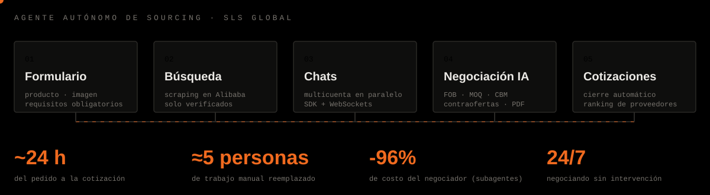

  

Construyo sistemas con IA que hacen trabajo real dentro de las empresas: agentes que atienden y negocian solos, automatizaciones que reemplazan tareas manuales y paneles conectados a los datos del negocio.

- **CEO @ [Forge](https://fluxia-forge.vercel.app)**: software con IA a medida de cada empresa. Lo construimos en 1 semana y se prueba 3 semanas en la operación real, sin compromiso.
- **AI Engineer @ SLS Global**: sistema autónomo de sourcing y negociación con proveedores.
- **AI Automation Engineer @ Bloop**: proyectos de transformación de empresas con IA.

👉 **[Ver portafolio completo](https://fluxia-forge.vercel.app/portafolio)**: proyectos, resultados y trayectoria.

  

## Proyecto destacado

  

**Agente autónomo de sourcing y negociación con proveedores.** Por fuera es un formulario: se carga el producto, se elige si la búsqueda es por texto o por imagen y se marcan los requisitos obligatorios. Por dentro, el sistema busca proveedores en Alibaba, abre chats desde varias cuentas en paralelo y negocia en inglés con agentes de IA hasta tener cotizaciones terminadas.

- Integración directa con el sistema de mensajería (SDK y WebSockets), sin depender de la interfaz.
- Lee cotizaciones en PDF, catálogos, Excel y fotos que mandan los proveedores.
- Agente negociador dividido en subagentes escalables, con controles por código para que no abandone ni cierre antes de tiempo.
- Base de datos en Supabase con cada conversación, cotización y costo por mensaje, más un dashboard en Next.js.

> **🔥 Hito · octubre 2026: −96% de costo en el agente negociador, con mejor calidad.**
> Dividí el agente principal en subagentes, armé un sandbox que reproduce llamadas reales de producción, puse a Claude Code a hacer QA respuesta por respuesta y recién ahí cambié de modelo.
> - Volumen real de septiembre: **US$ 279 → US$ 10** con la arquitectura nueva.
> - **96,2%** de respuestas correctas en 262 llamadas reales (antes ≤ 92,4%).
> - **−83%** solo por dividir en subagentes, con el mismo modelo.

## Otros proyectos

| Proyecto | Qué resolvió |
|---|---|
| **Bot de WhatsApp + CRM** · clínica dental | Respuesta instantánea y pipeline de ventas propio. Conversión por WhatsApp: casi **+70%**. |
| **Agente de IA interno** · desarrolladora inmobiliaria | 6 fuentes de información unificadas en una base. Consultas que llevaban días, ahora en **minutos**. |
| **Paneles de gestión sobre ERP** · empresa de autopartes | Conexión directa al ERP y 4 paneles con metas y alertas, en **2 semanas**. |
| **Disponibilidad hotelera automatizada** · empresa de turismo | n8n + Playwright + Railway: reportes al equipo comercial varias veces por día, sin intervención manual. |

## Contacto

  
  
  
  

