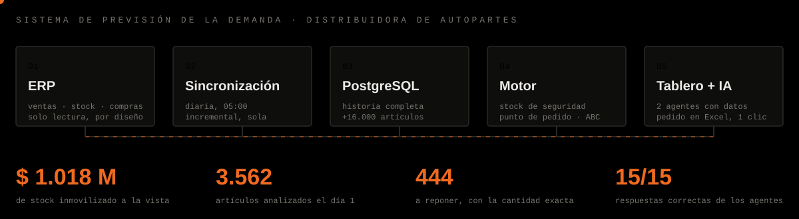
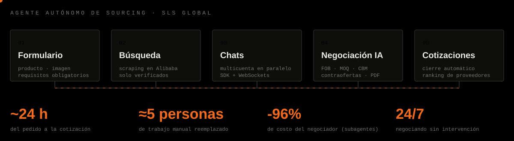
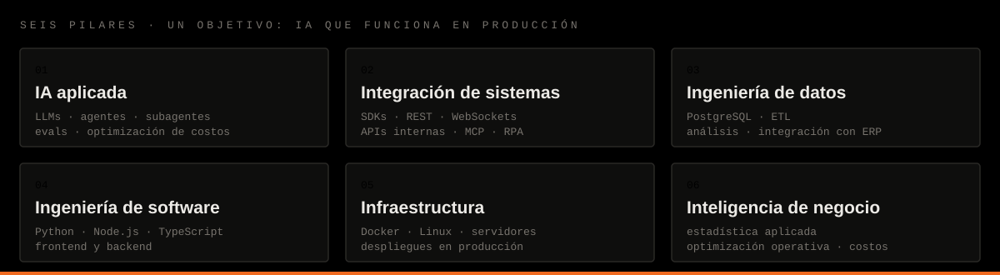

  

**AI Solutions Engineer** | Applied AI & Agentic Systems | Enterprise Integrations | End-to-End Production Deployment

Construyo sistemas con IA que corren dentro de la operación real de las empresas: agentes que negocian y responden solos, motores de previsión conectados al ERP e integraciones entre los sistemas que la empresa ya usa. Llevo cada proyecto de punta a punta, del problema del negocio a producción, y lo mido en horas y en plata.

👉 **[Ver portafolio completo](https://gustavobrizuela.fun)**: hitos, proyectos, experiencia y CV.

## Hitos 2026

| | Hito | Qué cambió |
|---|---|---|
| 📦 | **$ 1.018 M** · Sistema de previsión de la demanda | Una distribuidora de autopartes tenía el 35,5% del stock parado y compraba por intuición. Ahora un sistema en producción decide cada día qué comprar, cuánto y por qué. |
| 📉 | **−96%** · Costo de IA de un agente negociador | De US$ 279 a US$ 10 por mes con subagentes, y respuestas correctas de ≤ 92,4% a 96,2% en 262 llamadas reales. |
| 🤝 | **~24 h** · Sourcing autónomo de proveedores | Del pedido de producto a cotizaciones terminadas, con agentes de IA negociando 24/7. Hace el trabajo de ~5 personas. |

## Sistema de previsión de la demanda

  

**Distribuidora de autopartes, 2 sucursales, más de 16.000 artículos con stock.** Las compras dependían de mínimos cargados a mano hace años: $ 1.018 millones sin una venta en 6 meses y el 74% de los artículos de la marca principal con mínimo en 0, así que el ERP nunca avisaba que había que comprar. Sobrestock y quiebre al mismo tiempo. Lo diseñé, construí y puse en producción solo, de punta a punta.

- Integración de **solo lectura** con la API del ERP, sincronizada todos los días a las 5:00. Cero riesgo para la operación.
- Modelo de inventario **artículo por artículo** sobre 12 meses de ventas: venta diaria, demora real, stock de seguridad (`SS = ⌈Z·σ·√demora⌉`) y punto de pedido, con nivel de servicio de 99 / 95 / 90% según la clase ABC.
- Descuenta lo que ya viene en camino y redondea cada pedido al **múltiplo real del proveedor** (3.326 de 3.561 artículos cruzados con el catálogo del fabricante; los casos dudosos se marcan, no se adivinan).
- **Dos agentes de IA** con herramientas propias (dirección y compras) que responden solo con datos del sistema, con caché de contexto para que cada consulta cueste centavos. 15 de 15 correctas en los controles automáticos.
- Tablero web con login, explicación del cálculo de cada artículo y **pedido de compra en Excel en un clic**. Despliegue con Docker en servidor propio.

> El primer día en producción analizó **3.562 artículos** y armó solo el pedido: **444 a reponer**, con la cantidad exacta de cada uno. Antes de salir, el modelo se replicó en Excel con fórmulas vivas y se contrastó artículo por artículo.

## Agente autónomo de sourcing y negociación

  

**SLS Global, comercio exterior.** Por fuera es un formulario: se carga el producto, se elige si la búsqueda es por texto o por imagen y se marcan los requisitos obligatorios. Por dentro, el sistema busca proveedores en Alibaba, abre chats desde varias cuentas en paralelo y negocia en inglés con agentes de IA hasta tener cotizaciones terminadas.

- Integración directa con el sistema de mensajería (SDK y WebSockets), sin depender de la interfaz.
- Lee cotizaciones en PDF, catálogos, Excel y fotos que mandan los proveedores.
- Agente negociador dividido en subagentes escalables, con controles por código para que no abandone ni cierre antes de tiempo.
- Base de datos en Supabase con cada conversación, cotización y costo por mensaje, más un dashboard en Next.js.

> **Hito · octubre 2026: −96% de costo en el agente negociador, con mejor calidad.**
> Dividí el agente principal en subagentes, armé un sandbox que reproduce llamadas reales de producción, puse a Claude Code a hacer QA respuesta por respuesta y recién ahí cambié de modelo.
> - Volumen real de septiembre: **US$ 279 → US$ 10** con la arquitectura nueva.
> - **96,2%** de respuestas correctas en 262 llamadas reales (antes ≤ 92,4%).
> - **−83%** solo por dividir en subagentes, con el mismo modelo.

## Seis pilares

  

## Otros proyectos

| Proyecto | Qué resolvió |
|---|---|
| **Bot de WhatsApp + CRM** · clínica dental | Respuesta instantánea y pipeline de ventas propio. Conversión por WhatsApp: casi **+70%**. |
| **Agente de IA interno** · desarrolladora inmobiliaria | 6 fuentes de información unificadas en una base. Consultas que llevaban días, ahora en **minutos**. |
| **Paneles de gestión sobre ERP** · empresa de autopartes | Conexión directa al ERP y 4 paneles con metas y alertas, en **2 semanas**. |
| **Disponibilidad hotelera automatizada** · empresa de turismo | n8n + Playwright + Railway: reportes al equipo comercial varias veces por día, sin intervención manual. |

## Contacto

  
  
  
  

